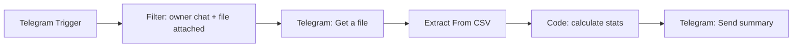

# Trade Journal Bot (n8n + Telegram)

Send your exported trade history to a Telegram bot and get a statistics summary back within seconds.

The bot receives a CSV file, n8n downloads and parses it, a JavaScript Code node calculates the statistics, and the result is sent back to the same chat. No spreadsheet work and no manual calculations.

> This is a learning and portfolio project. It is **not financial advice**.

## Features

- Accepts an exported trade-history **CSV** sent to a Telegram bot as a file
- Replies **only to the owner's chat**, so nobody else can use the bot
- Finds columns by **name**, so small differences between exports do not break it
- Calculates:
  - number of trades, wins and losses, and win rate
  - net P&L, and total fees and funding
  - average win, average loss, and average P&L per trade
  - profit factor
  - best and worst trade, and how much of the profit came from the best trade
  - maximum drawdown and longest losing streak
- Adds a warning when there are **fewer than 30 trades**, because the sample is too small to judge a strategy

## How it works



1. **Telegram Trigger** starts the workflow when a message arrives.
2. **Filter** keeps only messages from the owner's chat ID that include a file.
3. **Get a file** downloads the CSV from Telegram.
4. **Extract From CSV** turns each row into an item.
5. **Code in JavaScript** finds the columns, calculates the statistics, and builds a plain-text summary.
6. **Send a text message** replies with the summary.

## Tech stack

- [n8n](https://n8n.io) (self-hosted on Render, with a Supabase PostgreSQL database)
- Telegram Bot API
- JavaScript (n8n Code node)

## Example output

This is **sample data**, not real results.

```
Trade journal summary (2026-01-05 to 2026-01-19)
Trades: 12 (wins 7, losses 5)
Win rate: 58.33%
Net P&L: 42.30 USDT
Fees and funding: 5.30 USDT
Avg win: 12.40 | Avg loss: 8.90
Profit factor: 1.95
Avg per trade: 3.53 USDT
Best: 21.50 | Worst: -14.20
Max drawdown: 23.80 USDT
Longest losing streak: 3
Best trade = 50.83% of net profit
Note: under 30 trades, too few to judge a strategy.
```

## Setup

You need an n8n instance with a **public HTTPS URL**, because Telegram webhooks require HTTPS. Set the `WEBHOOK_URL` environment variable to that address.

1. Create a bot with [@BotFather](https://t.me/BotFather) and copy the bot token.
2. In n8n, create a new workflow and import `trade-journal.json` (menu **...** then **Import from file**).
3. Create a **Telegram** credential with your bot token and select it in all three Telegram nodes.
4. Send any message to your bot and read your **chat ID** from the Telegram Trigger output (`message.chat.id`).
5. Set your chat ID in the **Filter** node and in the final **Send a text message** node.
6. **Publish** the workflow.
7. Export your trades as a CSV from your exchange and send the file to your bot as a **File** (not a photo).

## Expected CSV columns

| Column | Required | Notes |
|---|---|---|
| Realized P&L | Yes | Treated as the **net** result of each trade |
| Opening Fee, Closing Fee, Funding Fee | No | Used for the fees and funding total |
| Trade Time | No | Used to sort trades, and for the date range and drawdown |

It was built against a futures exchange P&L export in which Realized P&L already includes fees. If your exchange reports gross P&L, adjust the Code node.

## Limitations

- Small samples are misleading. Treat the numbers as a record, not proof that a strategy works.
- Drawdown is calculated on the running realized P&L in USDT, not as a percentage of account size, because the export has no account balance.
- The export has no stop-loss or risk-per-trade data, so risk-based measures such as R-multiples are not available yet.
- It assumes a single currency (USDT).

## What I learned

- Filtering by chat ID is a simple but important safeguard for any bot that accepts files.
- Matching columns by name makes the workflow tolerate different exports.
- Plain-text output avoids Telegram formatting errors.
- A built-in small-sample warning keeps the results honest.

## Roadmap

- Log every export to Google Sheets
- Send an automatic weekly summary
- Add stop-loss and risk fields to calculate R-multiples
- Add short AI comments on trading habits

## Author

Den Mark T. Hernandez  
GitHub: [denmark-codes](https://github.com/dmhernandez-codes)  
LinkedIn: [Den Mark Hernandez](https://www.linkedin.com/in/den-mark-hernandez-09110b450)
